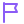

  

  
  
  

 

### &nbsp; Hey there

I'm an ICT engineering student at **SUP'COM** (Tunis) who likes building AI systems **end to end**: from the first ugly dataset to something a real person can use. I'm happiest when a problem is messy, a scanned PDF in three languages, a 3D CT scan, a stock market with very little data, and the solution has to actually hold up.

 

<table>
<tr>
<td width="50%" valign="top">

### &nbsp; What I can do

&nbsp; **LLM agents & RAG**: multi-agent systems on local models, with guardrails against hallucination 
&nbsp; **Knowledge graphs & GraphRAG**: connecting data so an assistant can reason over it 
&nbsp; **Document AI**: OCR + vision-language models that read tables, scans and multilingual PDFs 
&nbsp; **Smart search & recommendation**: semantic, hybrid and text-to-image search, ranking 
&nbsp; **Deep learning & computer vision**: training and evaluating models, 3D medical segmentation 
&nbsp; **Forecasting & anomaly detection**: time series, XGBoost, LSTM, early-warning signals 
&nbsp; **Local inference**: running models fast and privately with Ollama, llama.cpp, ONNX Runtime 
&nbsp; **Data pipelines & automation**: ingestion, ETL, scraping, event-driven workflows 
&nbsp; **Monitoring & quality checks**: observability, automatic error flagging, tests 
&nbsp; **Benchmarking**: comparing methods rigorously to pick what really works 
&nbsp; **Full-stack apps**: FastAPI and Spring Boot backends, Angular and Flutter front ends

</td>
<td width="50%" valign="top">

### &nbsp; What interests me

&nbsp; **Solving real needs**: using technology where it makes a real difference, not just because it's new 
&nbsp; **Understanding the business**: listening to what a team actually needs, then building what serves it 
&nbsp; **Automation & useful tools**: removing repetitive work so people can focus on what matters 
&nbsp; **Reliable data**: making data trustworthy first, then getting much more value out of it 
&nbsp; **Modeling & architecture**: designing solutions and system architectures, then optimising them 
&nbsp; **Learning by doing**: discovering new things by building them, not just reading about them 
&nbsp; **Teamwork**: building together, sharing ideas and learning from others 
&nbsp; **New connections**: meeting people with different backgrounds and points of view 
&nbsp; **New opportunities**: open to projects and challenges that make me grow 
&nbsp; **Hackathons**: tight deadline, one idea, ship it

</td>
</tr>
</table>

### &nbsp; Right now

&nbsp; Building a **financial document extraction platform for audit** with **EY Tunisia**: 13 AI models running locally, over 80% of tables read correctly 
&nbsp; Looking for a **4–6 month final-year internship (PFE) in Europe from February 2027**, in AI / LLM / computer vision

 

### &nbsp; Things I've built

<table>
<tr>
<td width="50%" valign="top">
&nbsp; <a href="https://github.com/CHAABEN-Chahin/wellvia"><b>Wellvia</b></a> 
An ESP32 wearable streams your vitals to a Flutter app; snap your meal and AI logs the nutrition. 
<code>Flutter</code> <code>FastAPI</code> <code>Firebase</code> <code>Ollama</code>
</td>
<td width="50%" valign="top">
&nbsp; <a href="https://github.com/CHAABEN-Chahin/lung-nodule-nnunet-prep"><b>Lung nodule detection</b></a> 
3D chest CT to nnU-Net to find lung nodules. Dice 0.72 ± 0.08. 
<code>PyTorch</code> <code>nnU-Net</code> <code>CT imaging</code>
</td>
</tr>
<tr>
<td width="50%" valign="top">
&nbsp; <a href="https://github.com/OussemaHarrabi/KANZ-Petitfour"><b>KANZ</b></a> · 1st place, IHEC CodeLab 2.0 
Making the Tunisian stock market readable: forecasts, news sentiment, anomaly alerts. 
<code>XGBoost</code> <code>LSTM</code> <code>OCR</code>
</td>
<td width="50%" valign="top">
&nbsp; <a href="https://github.com/Jawher-Sadok/VondraLink"><b>VondraLink</b></a> 
Find products by vibe and budget, not keywords: text and image search over CLIP embeddings. 
<code>CLIP</code> <code>Qdrant</code> <code>FastAPI</code>
</td>
</tr>
<tr>
<td width="50%" valign="top">
&nbsp; <a href="https://github.com/khaoula-mechria/bike"><b>BikeShare demand forecasting</b></a> 
Forecasting daily bike rentals in Washington D.C., adapted to predict 2026 with live weather. XGBoost test R² 0.927. 
<code>XGBoost</code> <code>scikit-learn</code> <code>SHAP</code>
</td>
<td width="50%" valign="top">
&nbsp; <a href="https://github.com/OussemaHarrabi/BMO"><b>BMO</b></a> 
A memory for your computer: screen activity becomes searchable memories and a knowledge graph. 
<code>Qdrant</code> <code>Neo4j</code> <code>Vision models</code>
</td>
</tr>
<tr>
<td width="50%" valign="top">
&nbsp; <a href="https://github.com/OussemaHarrabi/ENSTAB"><b>ENSTAB</b></a> · 3rd place, Hack4UCAR 
University data into dashboards, document search and plain-language SQL. 
<code>FastAPI</code> <code>pgvector</code> <code>Next.js</code>
</td>
<td width="50%" valign="top">
&nbsp; <a href="https://github.com/CHAABEN-Chahin/social-media-content-analyzer"><b>Social media analyzer</b></a> 
Fully local: scrape a post, OCR and transcribe it, let a small LLM make sense of it. 
<code>Playwright</code> <code>Whisper</code> <code>Ollama</code>
</td>
</tr>
<tr>
<td width="50%" valign="top">
&nbsp; <a href="https://github.com/CHAABEN-Chahin/jinen-nursery-platform"><b>JINEN</b></a> 
Nursery management with AI child-development tracking and a chatbot. 
<code>Spring Boot</code> <code>Angular</code> <code>MongoDB</code>
</td>
<td width="50%" valign="top">
&nbsp; <a href="https://chehin.chaaben.com"><b>More on my portfolio</b></a> 
Case studies, experience and everything that isn't on GitHub yet. 
<code>chehin.chaaben.com</code>
</td>
</tr>
</table>

### &nbsp; Tools I reach for

  

  
  
  
  
  
  
  
  
  

<b>ALSO FAMILIAR WITH</b> · a broad engineering background, comfortable beyond AI and in different kinds of teams

  
  
  
  
  
  

 

### &nbsp; Let's work together

Got a hard AI problem, an internship, a hackathon team that needs one more person, or just want to talk about local LLMs? 
**My inbox is open.** I reply in French, English or Arabic.

  

